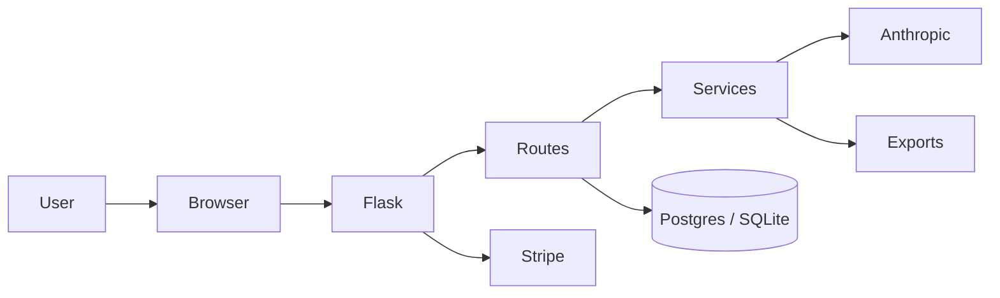

# Resume Tailor

A web app that rewrites your resume for a specific job posting using Claude.

You paste in your resume and a job description. The app reorders and rewords your existing experience to match what the role is asking for, without adding anything that is not already on your resume. It can also write a matching cover letter and show which keywords from the posting your resume is missing.

## Features

- Resume tailoring: rewrites your resume for one job description, prioritizing the most relevant experience and using the posting's language where it fits.
- Cover letter generation: writes a cover letter from your resume and the job description, ready to send with no placeholders.
- Keyword match score: compares the most frequent keywords in the job description against your resume and lists what matches and what is missing.
- Import from URL: pulls the text of a job posting from a link so you do not have to copy and paste it.
- Export: downloads the tailored resume as PDF or Word, and the cover letter as PDF.
- History: saves past tailoring results so you can come back to them.
- Accounts and billing: sign up, log in, reset your password, export or delete your data. Three free uses, then a Stripe subscription.

## Architecture



Request flow: the browser calls a route in app/api. The route validates input and calls a service in app/services. The service talks to Anthropic, scores keywords, or builds a document. The route saves the result through the models in app/models.py and returns JSON or a file.

## Tech stack

- Backend: Python, Flask, Flask-Login, Flask-SQLAlchemy, Flask-Limiter
- AI: Anthropic API (Claude)
- Database: PostgreSQL in production, SQLite locally
- Payments: Stripe Checkout, customer portal, and webhooks
- Documents: WeasyPrint for PDF, python-docx for Word
- Deployment: Docker and Gunicorn on Render
- Tests: pytest, ruff, GitHub Actions

## Project structure

```
app/
  config.py       # settings from the environment, with validation
  __init__.py     # app factory, blueprints, security headers
  models.py       # User and TailorResult models
  api/
    tailor.py     # tailoring, cover letters, keyword scoring, exports, URL import
    auth.py       # signup, login, password reset
    account.py    # password change, data export, account deletion
    billing.py    # Stripe checkout, portal, and webhooks
    pages.py      # landing, dashboard, and legal pages
  services/
    llm.py        # Anthropic client, prompts, model calls
    keywords.py   # keyword extraction and ATS scoring
    exports.py    # DOCX and PDF rendering
    job_import.py # fetch and parse a job posting from a URL
  templates/      # Jinja HTML pages
  static/         # CSS and JavaScript
tests/            # pytest suite, mocked Anthropic and Stripe calls
mcp_server/       # MCP server: tools the agent loop calls (see below)
run.py            # entry point
Dockerfile
render.yaml       # Render deployment config
```

## MCP server

The repo includes an MCP server in `mcp_server/` that exposes the app's services as tools for an agent. It runs over stdio using the MCP Python SDK v2 and is started by the agent host as a subprocess. The tool functions are plain Python functions that wrap the services in `app/services/`, so the agent loop can also call them in-process.

Run it with:

```bash
python -m mcp_server
```

Tools exposed so far:

| Tool | Description |
| --- | --- |
| fetch_job_posting | Fetch a job posting from a URL and return its text, title, and company |

## API endpoints

| Method | Path | Description |
| --- | --- | --- |
| POST | /api/tailor | Tailor a resume for a job description |
| POST | /api/cover-letter | Generate a cover letter |
| POST | /api/ats-score | Score a resume against a job description |
| POST | /api/import-jd | Import a job description from a URL |
| GET | /api/history | List past tailoring results |
| GET | /api/history/<id> | Get one tailoring result |
| GET | /api/download-docx/<id> | Download a tailored resume as Word |
| GET | /api/download-pdf/<id> | Download a tailored resume as PDF |
| GET | /api/download-cover-letter/<id> | Download a cover letter as PDF |
| POST | /auth/signup | Create an account |
| POST | /auth/login | Log in |
| GET | /auth/logout | Log out |
| POST | /auth/forgot-password | Request a password reset |
| POST | /auth/reset-password/<token> | Reset a password |
| POST | /billing/checkout | Start a Stripe checkout session |
| POST | /billing/portal | Open the Stripe customer portal |
| POST | /billing/webhook | Stripe webhook |
| GET | /account | Account settings page |
| POST | /account/change-password | Change password |
| GET | /account/export | Export account data as JSON |
| POST | /account/delete | Delete the account |
| GET | / | Landing page or dashboard |
| GET | /dashboard | Dashboard |
| GET | /privacy | Privacy policy |
| GET | /terms | Terms of service |

All /api routes except the webhook require a logged in user.

## Running locally

1. Clone the repo and install dependencies:

   ```bash
   git clone https://github.com/HridaySainathuni/resume-tailor-saas.git
   cd resume-tailor-saas
   pip install -r requirements.txt
   ```

2. Copy the example environment file and fill in your keys:

   ```bash
   cp .env.example .env
   ```

   | Variable | Description |
   | --- | --- |
   | SECRET_KEY | Random string used by Flask for sessions. Required in production. |
   | DATABASE_URL | Defaults to a local SQLite file |
   | FLASK_ENV | Set to production on Render. Development locally. |
   | FLASK_DEBUG | Set to 1 only for local debugging. Defaults to 0. |
   | ANTHROPIC_API_KEY | Your Anthropic API key |
   | STRIPE_SECRET_KEY, STRIPE_PUBLISHABLE_KEY | Stripe keys (test keys work) |
   | STRIPE_PRICE_ID | The Stripe price for the subscription |
   | STRIPE_WEBHOOK_SECRET | Secret for verifying Stripe webhooks |

3. Start the app:

   ```bash
   python run.py
   ```

   The app runs at http://localhost:5000.

WeasyPrint needs a few system libraries (Pango and Cairo) for PDF export. The Dockerfile installs them, so running with Docker is the easiest option if PDF export fails locally.

## Tests and CI

Install the dev dependencies, then run the tests and the linter:

```bash
pip install -r requirements-dev.txt
python -m pytest -q
python -m ruff check .
```

Tests use an in-memory SQLite database and mocked Anthropic calls. They never call a live API. GitHub Actions runs pytest and ruff on every pull request and on pushes to master.

## Deployment

The repo includes a render.yaml that sets up a Docker web service and a Postgres database on Render. Connect the repo in Render, add the environment variables above, and deploy. Set FLASK_ENV to production and SECRET_KEY to a random value.

## Next steps

- Turn tailoring into an agent that researches the company before writing.
- Add a check that compares the output against the original resume to catch anything the model added that was not there.
- Use past applications as context so later results improve.
