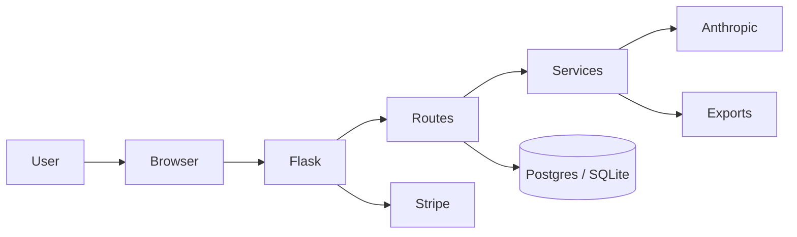

# Resume Tailor

A web app that rewrites your resume for a specific job posting using Claude.

You paste in your resume and a job description. The app reorders and rewords your existing experience to match what the role is asking for, without adding anything that is not already on your resume. It can also write a matching cover letter and show which keywords from the posting your resume is missing.

## Features

- Resume tailoring: rewrites your resume for one job description, prioritizing the most relevant experience and using the posting's language where it fits.
- Cover letter generation: writes a cover letter from your resume and the job description, ready to send with no placeholders.
- Keyword match score: compares the most frequent keywords in the job description against your resume and lists what matches and what is missing.
- Grounding check: checks every line of the tailored resume against your original resume and reports which lines are grounded and which are not.
- Import from URL: pulls the text of a job posting from a link so you do not have to copy and paste it.
- Export: downloads the tailored resume as PDF or Word, and the cover letter as PDF.
- History: saves past tailoring results so you can come back to them.
- Accounts and billing: sign up, log in, reset your password, export or delete your data. Three free uses, then a Stripe subscription.

## Architecture



Request flow: the browser calls a route in app/api. The route validates input and calls a service in app/services. The service talks to Anthropic, scores keywords, or builds a document. The route saves the result through the models in app/models.py and returns JSON or a file.

## Tech stack

- Backend: Python, Flask, Flask-Login, Flask-SQLAlchemy, Flask-Limiter
- AI: Anthropic API (Claude)
- Database: PostgreSQL in production, SQLite locally
- Payments: Stripe Checkout, customer portal, and webhooks
- Documents: WeasyPrint for PDF, python-docx for Word
- Deployment: Docker and Gunicorn on Render
- Tests: pytest, ruff, GitHub Actions

## Project structure

```
app/
  config.py       # settings from the environment, with validation
  __init__.py     # app factory, blueprints, security headers
  models.py       # User and TailorResult models
  agent.py        # agent loop: gather context, drive the tool-calling loop, save deliverables
  api/
    tailor.py     # tailoring, cover letters, keyword scoring, exports, URL import
    auth.py       # signup, login, password reset
    account.py    # password change, data export, account deletion
    billing.py    # Stripe checkout, portal, and webhooks
    pages.py      # landing, dashboard, and legal pages
  services/
    llm.py        # Anthropic client, prompts, model calls
    keywords.py   # keyword extraction and ATS scoring
    exports.py    # DOCX and PDF rendering
    job_import.py # fetch and parse a job posting from a URL
  templates/      # Jinja HTML pages
  static/         # CSS and JavaScript
tests/            # pytest suite, mocked Anthropic and Stripe calls
mcp_server/       # MCP server: tools the agent loop calls (see below)
scripts/demo.py   # live demo: run the agent loop on sample data and print the trace
run.py            # entry point
Dockerfile
render.yaml       # Render deployment config
```

## MCP server

The repo includes an MCP server in `mcp_server/` that exposes the app's services as tools for an agent. It runs over stdio using the MCP Python SDK v2 and is started by the agent host as a subprocess. The tool functions are plain Python functions that wrap the services in `app/services/`, so the agent loop can also call them in-process.

Run it with:

```bash
python -m mcp_server
```

Tools exposed:

| Tool | Description |
| --- | --- |
| fetch_job_posting | Fetch a job posting from a URL and return its text, title, and company |
| research_company | Look up a company on Wikipedia and return its summary and page URL |
| read_resume | Return the user's most recent resume text from their latest tailoring result |
| get_past_applications | List the user's past applications, newest first, with job title, company, and date |

## Agent loop

The agent loop lives in `app/agent.py` and turns one job posting into a tailored resume and a cover letter.

`run_agent(job_url, user_id)` works in three steps:

1. `gather_context` calls all four tools up front: `fetch_job_posting` for the posting, `research_company` for the posting's company, `read_resume` for the user's resume, and `get_past_applications` for their past applications.
2. A plain Anthropic tool-calling loop drives the model over those same four tools, up to 10 tool turns, until the model replies with the finished deliverables. The model writes the tailored resume under `=== TAILORED RESUME ===` and the cover letter under `=== COVER LETTER ===`, and `parse_deliverables` splits the reply on those markers.
3. The tailored resume is scored against the job description with the keyword helper, and both deliverables are saved as a `TailorResult` row.

If the job posting cannot be fetched or the resume cannot be read, the loop raises before any model call and saves nothing. A reply without both marked sections also raises and saves nothing.

The old single-call path in `app/services/llm.py` and the `/api/tailor` route is unchanged. The agent loop is a separate entry point that reuses the same services and tools.

## Grounding verifier

The grounding verifier lives in `app/verifier.py` and checks a tailored resume against the source resume, line by line, to catch anything the model added that was not there.

`verify_grounding(tailored_text, resume_text)` returns a `GroundingReport` with one verdict per non-blank line of the tailored resume:

| Verdict | Match | Meaning |
| --- | --- | --- |
| grounded | exact | The line matches a line of the source resume after normalizing case, punctuation, and whitespace |
| grounded | fuzzy | The line does not match exactly, but closely resembles a source line (similarity ratio of at least 0.8) |
| unsupported | none | The line matches no source line, exactly or closely |

The report also exposes `grounding_rate`, the share of checked lines with a grounded verdict (0.0 when there are no lines). Blank lines are skipped and are not counted.

The agent loop runs the verifier on every finished run: `run_agent` calls `verify_grounding` on the tailored resume against the source resume and returns the report in its result dict under `"grounding_report"`, alongside the tailored resume, cover letter, ATS score, and result id. The verifier does not change what the loop writes or saves: the tailored resume and cover letter are saved as before, and the report is returned to the caller for review.

## Eval suite

The eval suite lives in `app/evals.py` and compares the three tailoring approaches on resume/job fixture pairs.

`run_eval(pairs, client=None)` runs each pair through all three approaches, the single-call baseline, the agent loop, and the agent loop with the grounding verifier, and scores each tailored resume three ways:

- **Fabrication rate**: the share of tailored lines the verifier finds unsupported by the source resume.
- **Keyword coverage**: the share of the job description's top keywords present in the tailored resume, from the keyword scorer.
- **Judge relevance**: a small LLM judge reads the tailored resume and the job description and returns a one-word verdict, RELEVANT or NOT_RELEVANT. A verdict the parser cannot read counts as not relevant.

`aggregate_results(pair_results)` summarizes each approach across the pairs: the mean fabrication rate, mean keyword coverage, and share of relevant pairs, each with a Wilson score interval at 95 percent confidence. The interval treats the number of pairs as the sample size, so it tightens as more pairs agree.

The fixture pairs are synthetic and exist only to exercise the harness. The real eval dataset is a later slice. Tests use a mocked Anthropic client, so the suite never calls a live API.

## Tracing and live demo

The agent loop is traced with OpenTelemetry (see `app/tracing.py`). Each run emits one `agent.run` span for the whole run, and one `tool.<name>` child span per tool call inside the loop. Each tool span carries `tool.name` and `tool.success` attributes, and records the exception when a tool call fails. Spans print to the console by default; tests pass an in-memory exporter to `configure_tracing` and inspect the finished spans directly.

Run the live demo with:

```bash
python scripts/demo.py --fake
```

The demo runs `run_agent` end to end on a small sample job posting and a sample resume, using a fake model client and canned job posting and company data, so it needs no API key and makes no network calls. With a real Anthropic client instead, run `python scripts/demo.py` with `ANTHROPIC_API_KEY` set. The demo prints the tailored resume, the grounding report with the grounding rate and one verdict per line, and the trace spans the run emitted with their attributes.

## API endpoints

| Method | Path | Description |
| --- | --- | --- |
| POST | /api/tailor | Tailor a resume for a job description |
| POST | /api/cover-letter | Generate a cover letter |
| POST | /api/ats-score | Score a resume against a job description |
| POST | /api/import-jd | Import a job description from a URL |
| GET | /api/history | List past tailoring results |
| GET | /api/history/<id> | Get one tailoring result |
| GET | /api/download-docx/<id> | Download a tailored resume as Word |
| GET | /api/download-pdf/<id> | Download a tailored resume as PDF |
| GET | /api/download-cover-letter/<id> | Download a cover letter as PDF |
| POST | /auth/signup | Create an account |
| POST | /auth/login | Log in |
| GET | /auth/logout | Log out |
| POST | /auth/forgot-password | Request a password reset |
| POST | /auth/reset-password/<token> | Reset a password |
| POST | /billing/checkout | Start a Stripe checkout session |
| POST | /billing/portal | Open the Stripe customer portal |
| POST | /billing/webhook | Stripe webhook |
| GET | /account | Account settings page |
| POST | /account/change-password | Change password |
| GET | /account/export | Export account data as JSON |
| POST | /account/delete | Delete the account |
| GET | / | Landing page or dashboard |
| GET | /dashboard | Dashboard |
| GET | /privacy | Privacy policy |
| GET | /terms | Terms of service |

All /api routes except the webhook require a logged in user.

## Running locally

1. Clone the repo and install dependencies:

   ```bash
   git clone https://github.com/HridaySainathuni/resume-tailor-saas.git
   cd resume-tailor-saas
   pip install -r requirements.txt
   ```

2. Copy the example environment file and fill in your keys:

   ```bash
   cp .env.example .env
   ```

   | Variable | Description |
   | --- | --- |
   | SECRET_KEY | Random string used by Flask for sessions. Required in production. |
   | DATABASE_URL | Defaults to a local SQLite file |
   | FLASK_ENV | Set to production on Render. Development locally. |
   | FLASK_DEBUG | Set to 1 only for local debugging. Defaults to 0. |
   | ANTHROPIC_API_KEY | Your Anthropic API key |
   | STRIPE_SECRET_KEY, STRIPE_PUBLISHABLE_KEY | Stripe keys (test keys work) |
   | STRIPE_PRICE_ID | The Stripe price for the subscription |
   | STRIPE_WEBHOOK_SECRET | Secret for verifying Stripe webhooks |

3. Start the app:

   ```bash
   python run.py
   ```

   The app runs at http://localhost:5000.

WeasyPrint needs a few system libraries (Pango and Cairo) for PDF export. The Dockerfile installs them, so running with Docker is the easiest option if PDF export fails locally.

## Tests and CI

Install the dev dependencies, then run the tests and the linter:

```bash
pip install -r requirements-dev.txt
python -m pytest -q
python -m ruff check .
```

Tests use an in-memory SQLite database and mocked Anthropic calls. They never call a live API. GitHub Actions runs pytest and ruff on every pull request and on pushes to master.

## Deployment

The repo includes a render.yaml that sets up a Docker web service and a Postgres database on Render. Connect the repo in Render, add the environment variables above, and deploy. Set FLASK_ENV to production and SECRET_KEY to a random value.

## Next steps

- Use past applications as context so later results improve.
